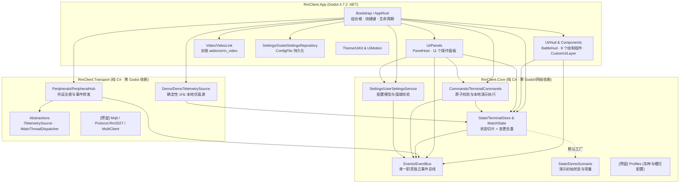
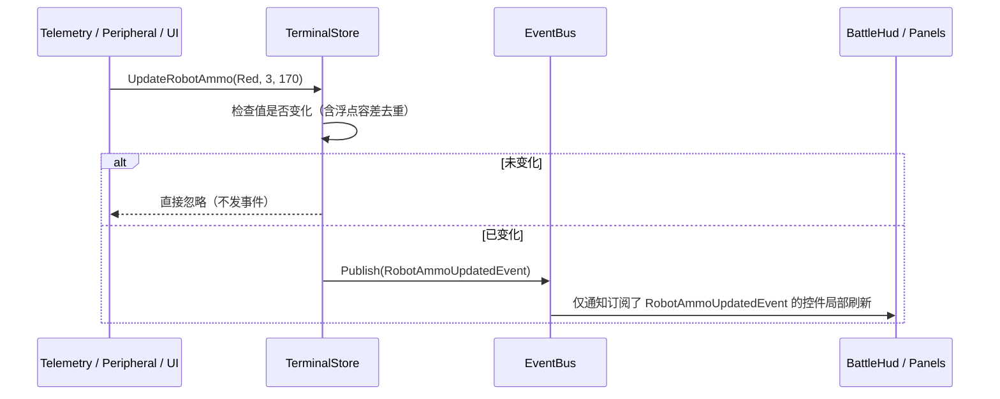

# RoboMaster 自定义选手端 · 项目架构说明

> 本文档描述当前 `rm-custom-client`（Godot 4.7.2 .NET + .NET 8）的实际代码架构、模块边界、事件流转与扩展预留，供团队开发、联调与后续功能接入参考。

---

## 1. 总体定位与技术栈

* **目标**：完全替代 RoboMaster 官方选手端的自定义客户端，前后端与通信协议严格分层，以单一职责的独立事件驱动 UI 更新，图传采用独立高性能解码链路。
* **运行环境**：
  * 前端与场景引擎：**Godot 4.7.2 .NET**（`GL Compatibility` 渲染器，设计分辨率 `1920×1080`，`canvas_items + expand` 自适应布局）
  * 领域与传输层：**.NET 8**（纯 C# 类库，零 Godot 依赖）
  * 原生图传扩展：`addons/rm_video`（来自 `PnX-HKUSTGZ/rm_udp_streamer`，UDP 3334 HEVC 硬件/软件解码与零回读显示）
* **命名约定**：`rm-custom-client/` 仓库内所有目录名、文件名、类名、标识符与代码注释统一使用英文；仅面向操作手的 UI 显示文案保留中文。

---

## 2. 工作区与代码仓库结构

```text
custom client/                        # 本地工作区根
├── rm-custom-client/                 # 【独立 Git 仓库】自定义客户端主工程
│   ├── RmClient.sln                  # .NET 8 解决方案入口
│   ├── Directory.Build.props         # 统一 C# 语言版本、Nullable 与隐式 using 策略
│   ├── .github/workflows/ci.yml      # GitHub Actions 自动化验证（复用 tools/verify.ps1）
│   ├── proto/                        # RM2027 V1.0.0 .proto 协议定义（与后端同步）
│   ├── docs/                         # 架构与设计文档
│   ├── tools/                        # 一键验证脚本 verify.ps1、HEVC 发包脚本 send_hevc.py
│   ├── src/
│   │   ├── RmClient.Core/            # 纯 C# 领域与事件总线层（零 Godot / 网络依赖）
│   │   ├── RmClient.Transport/       # 纯 C# 数据源、外设与协议传输层（零 Godot 依赖）
│   │   └── RmClient.App/             # Godot 4.7.2 .NET 前端工程（场景、UI、图传桥接）
│   └── tests/
│       ├── RmClient.Core.Tests/      # Core 纯 C# xUnit 单元测试
│       ├── RmClient.Transport.Tests/ # Transport 纯 C# xUnit 单元测试
│       └── GodotIntegration/         # Godot C# SceneTree 自检说明
├── vendor/                           # 第三方与官方对照（不进主仓库）
│   ├── rm2027-comm-backend/          # RM2027 C++ 协议后端与模拟裁判服务器（独立 Git）
│   ├── official-client/              # 官方选手端（对照参考）
│   ├── official-engine/              # 官方赛事引擎
│   └── shark-data-server/            # 后端 Node 交叉验证依赖
├── references/                       # 官方协议/界面手册、HUD 设计稿与截图对照
└── archive/                          # 迁移前 GDScript 完整备份（zip + 只读目录）与历史记录
```

---

## 3. 三层单向依赖架构

解决方案通过三个 `.NET` 程序集强制隔离职责，依赖方向严格单向，编译期杜绝跨层污染：



### 各层红线与约束
| 层级 | 允许依赖 | 严禁行为 |
|---|---|---|
| **`RmClient.Core`** | 仅 .NET 8 BCL | 严禁引用 `Godot`、MQTT、Protobuf、文件/网络 I/O |
| **`RmClient.Transport`** | `RmClient.Core` + 通信库 | 严禁引用 `Godot` 或直接操作场景树；后台线程必须经 `IMainThreadDispatcher` 切回主线程 |
| **`RmClient.App`** | `RmClient.Core`、`RmClient.Transport`、`GodotSharp` | UI 层严禁直接引用 MQTT/Protobuf 或调用原生 `RmVideoSession` / `RmVideoSurface` |

---

## 4. 核心机制设计

### 4.1 单一职责事件总线（`IEventBus` / `EventBus`）

* **按类型独立隔离**：每种业务变更对应一个独立不可变 `sealed record`（实现 `IDomainEvent`），订阅者只监听自己关心的事件类型，彻底消除旧版“任意字段变化触发全 HUD 重绘”的问题。
* **异常隔离**：`EventBus.Publish<TEvent>` 对每个订阅者调用包裹 `try/catch`，单个订阅者抛出异常时交由可注入的错误回调（Godot 侧绑定 `GD.PushError`）记录，**不会中断后续订阅者，也不会冒泡影响发布者**。
* **并发与重入安全**：内部使用锁保护订阅表、发布前拷贝快照数组，支持在事件回调内部安全取消订阅（`IDisposable` 令牌幂等释放）。

#### 现有领域事件清单（按命名空间）

| 命名空间 | 事件类型 | 含义与触发源 |
|---|---|---|
| `Events.Match` | `MatchClockUpdatedEvent` | 局数与倒计时秒数变化 |
| | `TeamScoreUpdatedEvent` | 红/蓝方比分变化 |
| | `BaseHealthUpdatedEvent` | 基地/前哨站血量变化 |
| | `CreditsUpdatedEvent` | 金币余额变化 |
| | `DemoStateResetEvent` | 演示状态重置 |
| `Events.Robot` | `ActiveRobotChangedEvent` | 当前选中/登录机器人切换 |
| | `RobotHealthUpdatedEvent` | 指定机器人血量/上线状态变化 |
| | `RobotAmmoUpdatedEvent` | 指定机器人弹量/初速变化 |
| | `RobotHeatPowerUpdatedEvent` | 指定机器人枪口热量/底盘功率变化 |
| | `RobotEnergyUpdatedEvent` | 指定机器人底盘能量/缓冲能量变化 |
| | `RobotPositionUpdatedEvent` | 指定机器人归一化场地坐标变化 |
| `Events.Tactical` | `MapMarkerSubmittedEvent` | 大地图战术标记提交 |
| | `RobotMessageUpdatedEvent` | 机器人操作提示更新 |
| | `SystemEventAppendedEvent` | 系统事件日志追加（有界上限 50 条） |
| `Events.Runtime` | `ConnectionStatusChangedEvent` | 通信连接状态与标签变化 |
| | `ModuleStatusUpdatedEvent` | 硬件/系统模块在线状态变化 |
| | `VideoStatusUpdatedEvent` | 图传状态、活跃标记与错误变化 |
| | `SettingsChangedEvent` | 用户设置变更 |
| | `PeripheralConnectionChangedEvent` | 外设连接/断开 |
| | `PeripheralInputReceivedEvent` | 归一化外设输入通道数据 |
| | `PeripheralFaultEvent` | 外设非致命故障日志 |
| `Events.Commands` | `CommandFeedbackEvent` | 命令执行回执（提示文案 + 是否接受） |

### 4.2 状态切片、变更去重与演示解耦



* **状态切片与首帧同步**：`TerminalStore` 持有当前 `MatchState`，用于新打开面板或首帧初始化时同步读取；运行时增量更新一律通过事件驱动。
* **高频字段去重**：所有变更方法（包括 `SetConnectionStatus`、`UpdateRobotHeatAndPower`、`UpdateRobotEnergy`、`UpdateRobotAmmo` 等）均具备相等性或 `0.0001f` 浮点容差去重，防止高频遥测/心跳造成无效重绘。
* **演示数据解耦**：演示常量与初始状态抽离在 `DemoScenario.cs`；`TerminalStore` 接受可选的 `Func<MatchState>? initialStateFactory`，未来接入真机时可直接注入真实初始状态工厂而无需修改 Store。

### 4.3 命令校验层（`TerminalCommands`）

* 负责所有操作意图（17 mm / 42 mm 补弹、4 类远程兑换、大地图标记、本地登录切换、部署、能量机关、演示重置）的前置校验。
* **原子性原则**：所有余额、上限、坐标有限性与合法性检查全部通过后，才修改状态并发布事件；拒绝路径只发布 `CommandFeedbackEvent(message, Accepted: false)`，不扣款、不污染事件日志。

### 4.4 独立图传链路（`VideoLink` → `VideoSurface`）

```text
UDP 3334 (8B 大端包头 + HEVC)
  └─► RmVideoSession (addons/rm_video 原生线程：收包 / 重组 / 硬解或软解)
        ├─► RmVideoSurface (由 VideoSurface 全屏托管，CUDA→OpenGL 零回读或 CPU 上传)
        └─► VideoLink.cs (主线程 4Hz 轮询状态、HEVC 参数 SHA256 缓存、5s 非阻塞停止收尾)
              └─► AppRoot.cs 投影到 TerminalStore.SetVideoStatus() → 发布 VideoStatusUpdatedEvent
```

* 无头运行（`--headless`）下不挂载原生渲染节点 `RmVideoSurface`，保证 CI 与自动化测试稳定退出。

### 4.5 UI 组合根与面板生命周期

* **`AppRoot`（`scenes/main.tscn`）**：唯一组合根，负责组装服务、绑定事件、管理全局快捷键：
  * **按住型面板**：`Tab`（记分板）、`` ` ``（模块）、`F12`（帮助），松开自动恢复之前打开的切换型面板；
  * **切换型面板**：`P`（设置）、`M`（大地图，激活时拦截 `I` 给警戒标记）、`O`/`I`（17/42 mm 补弹）、`H`（远程兑换）、`F`/`K`（机关/部署）、`F8`（结算）、`Esc`（关闭）；
  * **演示辅助键**：`F5`（重置）、`F6`（暂停/继续）。
* **`TerminalPanel` 基类**：隐藏时收到订阅事件仅标记 `_dirty = true`，重新显示时才同步刷新；内置防抖保存（`SettingsPanel` 250 ms 合并写盘）与二次确认弹窗（`AskConfirmation`）。
* **`UiMotion`**：实战优先设计，面板首帧全不透明立即显示，无入场延迟；按钮与数值条仅保留 60 ms 轻量过渡，支持 `--no-ui-motion` 一键关闭。

---

## 5. 新功能预留目录（已就位，待下一阶段实现）

| 目录 | 所属程序集 | 预留职责 |
|---|---|---|
| `src/RmClient.Transport/Mqtt/` | `RmClient.Transport` | 基于 MQTTnet 的 Broker 连接、指数退避重连、QoS 1 订阅、逐主题过期判定 |
| `src/RmClient.Transport/Protocol/Rm2027/` | `RmClient.Transport` | 基于 `proto/*.proto` 的 Protobuf 编解码、发送前约束校验与 32 条消息 ↔ 领域事件映射 |
| `src/RmClient.Transport/MultiClient/` | `RmClient.Transport` | 多自定义客户端唯一会话标识、幂等去重与多端协同 |
| `src/RmClient.Core/Profiles/` | `RmClient.Core` | 车种定义（英雄/步兵/工程/哨兵/空中/飞镖）与 HUD 上半区左右槽位布局配置 |
| `src/RmClient.App/scripts/Ui/Widgets/` | `RmClient.App` | 按车种动态装配到 HUD 预留槽位的定制小组件 |
| `src/RmClient.App/scripts/Ui/CustomProtocol/` | `RmClient.App` | 官方 RM2027 `0x0310` / `0x0311` 自定义绘图协议渲染器 |

---

## 6. 自动化验证与 CI 体系

本地与 GitHub Actions 共用同一套验收入口 [tools/verify.ps1](../tools/verify.ps1)：

```powershell
# 一键运行：dotnet build → dotnet test → Godot --headless --import → Godot C# --self-test
.\tools\verify.ps1
```

* **纯 C# 单元测试**（`dotnet test RmClient.sln`）：覆盖 `EventBus`（含异常隔离）、`TerminalStore`（含去重与自定义状态工厂）、`TerminalCommands`、`UserSettingsService`、`DemoTelemetrySource` 与 `PeripheralHub`。
* **Godot SceneTree 集成自检**（`AppSelfTest.cs`，零 `.gd` 脚本）：在真实 Godot 4.7.2 .NET 运行时中验证场景绑定、11 个面板互斥、按住/切换快捷键、二次确认、地图标记、设置投影、`F5` 重置及 `rm_video` 原生类注册（共 50 项断言）。
* **多级 Godot 自动探测**：`verify.ps1` 依次检查 `-GodotConsolePath` → `$env:GODOT_PATH` → WinGet/CI/ProgramFiles 常见安装目录 → `PATH`，并避免直接调用易在无头 `.NET` 下挂起的 WinGet shim。
