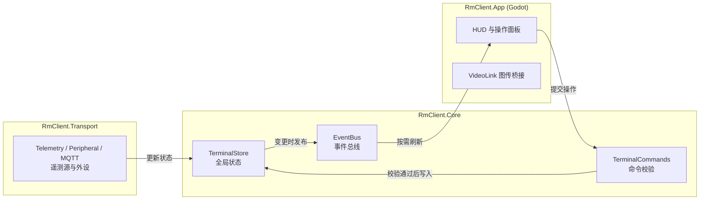

# PnX RM27自定义客户端项目架构说明（26.11.26更新）

本项目基于 **Godot 4.7.2 .NET** 与 **.NET 8** 构建，目标是替代官方选手端，并支持多客户端协同与自定义功能扩展。

整体设计将前端界面、领域状态与底层通信拆分为独立的程序集，保持单向依赖；图传视频流则通过独立的原生扩展解码渲染，与业务状态通道分离。

> **命名约定**：仓库内的目录、文件名、类型标识符及代码注释统一使用英文，仅面向用户的界面显示文案保留中文。

## 目录结构

### 仓库顶层概览

```text
rm-custom-client/
├── RmClient.sln                  # .NET 8 解决方案
├── Directory.Build.props         # 统一编译配置与语言版本
├── proto/                        # RM2027 V1.0.0 协议定义（与通信后端同步）
├── tools/                        # 验证脚本 verify.ps1、HEVC 测试发包脚本 send_hevc.py
├── src/
│   ├── RmClient.Core/            # 领域状态、事件总线、命令校验、配置模型（纯 C#）
│   ├── RmClient.Transport/       # 数据源、外设接入、协议与传输适配（纯 C#）
│   └── RmClient.App/             # Godot 前端工程（场景、HUD、面板、图传封装）
└── tests/
    ├── RmClient.Core.Tests/      # Core 单元测试
    ├── RmClient.Transport.Tests/ # Transport 单元测试
    └── GodotIntegration/         # Godot 场景集成自检说明
```

工作区外层的 `vendor/` 存放通信后端、官方选手端与赛事引擎（仅用于本地联调与对照，不纳入本仓库），`references/` 存放规则手册与界面参考图，`archive/` 为早期 GDScript 验证版的归档备份。

### `src/` 源码子目录说明

#### 1. `src/RmClient.Core/`（领域核心层）
- `State/`：全局状态仓库 `TerminalStore`、比赛状态结构 `MatchState`、基础领域类型 `DomainTypes` 及演示初始数据 `DemoScenario`。
- `Events/`：事件总线 `EventBus`，以及按业务划分的五个事件子目录（`Match/`、`Robot/`、`Tactical/`、`Runtime/`、`Commands/`）。
- `Commands/`：用户操作前置校验与状态变更入口 `TerminalCommands`。
- `Settings/`：用户配置数据模型与值域校验逻辑 `UserSettings`。
- `Profiles/`（预留）：各兵种特性配置与 HUD 槽位布局定义。

#### 2. `src/RmClient.Transport/`（传输与外设适配层）
- `Abstractions/`：遥测数据源接口 `ITelemetrySource` 与跨线程主线程调度接口 `IMainThreadDispatcher`。
- `Demo/`：1 Hz 确定性本地仿真数据源 `DemoTelemetrySource`。
- `Peripherals/`：自定义外设注册、启停与输入通道转发中心 `PeripheralHub`。
- `Mqtt/`（预留）：MQTT 客户端连接、断线重连与分主题超时管理。
- `Protocol/Rm2027/`（预留）：基于 `proto/` 的 RM2027 V1.0.0 Protobuf 编解码与事件映射。
- `MultiClient/`（预留）：多客户端会话标识、消息去重与多端状态同步。

#### 3. `src/RmClient.App/`（Godot 前端应用层）
- `addons/rm_video/`：原生 UDP HEVC 图传解码与零回读渲染扩展（GDExtension）。
- `assets/`：机器人立绘（`portraits/`）、场地地图与阵营图标（`reference/`）及全局主题资源（`theme/`）。
- `scenes/`：主场景 `main.tscn`、战斗 HUD 场景 `hud/battle_hud.tscn` 及 11 个独立弹窗场景 `panels/*.tscn`。
- `scripts/Bootstrap/`：组合根与快捷键管理 `AppRoot`、主线程调度实现 `GodotMainThreadDispatcher` 及无头集成自检 `AppSelfTest`。
- `scripts/Ui/`：界面脚本，进一步细分为：
  - `Components/`：血条、准星、机器人卡片、小地图、图传画布等基础控件；
  - `Hud/`：主界面布局控制器 `BattleHud` 与扩展挂载层 `CustomUiLayer`；
  - `Panels/`：面板宿主 `PanelHost`、面板基类 `TerminalPanel` 及各功能面板脚本；
  - `Widgets/`（预留）：按兵种动态挂载的专属 HUD 组件；
  - `CustomProtocol/`（预留）：官方 `0x0310` / `0x0311` 自定义图形协议渲染器。
- `scripts/Video/`：原生图传会话生命周期管理、状态轮询与 HEVC 参数集缓存 `VideoLink`。
- `scripts/Settings/`：基于 Godot `ConfigFile` 的本地设置读写实现 `GodotSettingsRepository`。
- `scripts/Theme/`：UI 样式构建工具 `UiKit` 与轻量过渡控制 `UiMotion`。

## 分层与依赖关系

解决方案划分为三个 `.NET` 程序集，依赖方向保持单向（`App` → `Transport` → `Core`）：



- **`RmClient.Core`**：仅依赖 .NET 8 基础类库，不引入 Godot、网络通信或文件 I/O。集中维护比赛状态、领域事件、命令校验与设置模型，可直接通过纯 C# 单元测试验证。
- **`RmClient.Transport`**：依赖 `Core`，负责外部数据接入与协议转换（当前包含本地演示源 `DemoTelemetrySource` 与外设中心 `PeripheralHub`，后续接入 MQTT 与 RM2027 协议）。不引入 Godot 依赖；后台线程回调统一通过 `IMainThreadDispatcher` 切回主线程。
- **`RmClient.App`**：Godot 前端工程，负责场景组织、HUD 绘制、交互面板、输入映射及图传显示。UI 组件仅依赖 `Core` 的状态与事件接口，不直接引用通信库或底层原生图传节点。

## 核心机制

### 1. 状态管理与事件分发

比赛运行状态由 `TerminalStore`（内部维护 `MatchState`）统一管理，采用「首帧读快照、运行听事件」的模式：

- **初始同步**：主界面初始化或面板首次打开时，直接从 `TerminalStore` 读取当前状态。演示模式的默认数据独立存放在 `DemoScenario.cs` 中，接入实机时可通过注入初始状态工厂替换。
- **按需更新**：运行期间的状态变更通过 `EventBus` 发布具体的不可变事件（如血量变化发布 `RobotHealthUpdatedEvent`，弹量变化发布 `RobotAmmoUpdatedEvent`），各 UI 控件仅订阅自身关心的事件做局部刷新，避免整屏重绘。
- **变更去重与异常隔离**：`TerminalStore` 在写入前会对新旧值做相等性判断（浮点数带 `0.0001f` 容差），数值未变时不触发事件，减少高频遥测带来的无效刷新。`EventBus` 对单个订阅者的回调异常做了捕获与日志转发，不会中断其他订阅者或影响发布方。

领域事件按职责划分在 `Core/Events/` 下的五个命名空间中：
- `Match`：局数与倒计时、红蓝比分、基地与前哨血量、金币余额、演示状态重置
- `Robot`：当前操控机器人切换、血量与在线状态、弹量与初速、枪口热量与底盘功率、底盘能量、场地坐标
- `Tactical`：大地图战术标点、机器人状态提示、系统事件日志
- `Runtime`：通信连接状态、模块在线状态、图传状态、用户设置变更、外设连接与输入通道
- `Commands`：操作命令执行结果回执

### 2. 命令校验

补弹（17 mm / 42 mm）、远程兑换、大地图标点、机器人切换及机关/部署等用户操作，统一提交给 `TerminalCommands` 处理，不在 UI 层直接修改状态。

`TerminalCommands` 会先完成余额、购买上限及坐标合法性等前置检查：全部通过后才更新 `TerminalStore` 并写入日志；未通过时仅发布 `CommandFeedbackEvent` 返回拒绝原因，保证状态不被部分修改。

### 3. 界面组织与面板生命周期

主场景 `scenes/main.tscn` 的根节点 `AppRoot` 作为组合根，负责组装各层服务、绑定事件并统一管理全局快捷键：

- **按住型面板**：`Tab`（记分板）、`` ` ``（模块状态）、`F12`（快捷键说明），松开按键后自动恢复此前打开的常驻面板。
- **切换型面板**：`P`（设置）、`M`（大地图，激活时 `I` 键优先用于警戒标点）、`O` / `I`（17 mm / 42 mm 补弹）、`H`（远程兑换）、`F` / `K`（机关 / 部署）、`F8`（结算）、`Esc`（关闭当前面板）。
- **演示控制**：`F5` 重置演示状态，`F6` 暂停或恢复倒计时。

各弹窗面板均继承自 `TerminalPanel`。面板处于隐藏状态时，收到订阅事件仅标记为待刷新，待下次显示时再同步更新控件；`SettingsPanel` 内置 250 ms 防抖写盘，避免连续调整参数时频繁触发文件写入。为优先保证操作响应，面板打开时首帧直接显示，不设入场延迟；按钮与数值条仅保留 60 ms 轻量过渡（可通过启动参数 `--no-ui-motion` 关闭）。

### 4. 图传链路

图传数据独立于业务事件流，由原生扩展 `addons/rm_video` 处理：

```text
UDP 3334 (8 字节大端包头 + HEVC 码流)
  └─► RmVideoSession（原生工作线程：收包、分片重组、硬件/软件解码）
        ├─► RmVideoSurface（由 VideoSurface 托管渲染，支持 CUDA→OpenGL 零回读上屏）
        └─► VideoLink.cs（主线程 4 Hz 轮询状态、缓存 HEVC 参数集、管理会话启停收尾）
```

`AppRoot` 将 `VideoLink` 轮询得到的状态同步至 `TerminalStore`，HUD 与设置页仅读取格式化后的状态信息。在 `--headless` 无头模式下跳过挂载 `RmVideoSurface`，确保命令行自检与 CI 环境能够正常退出。

## 扩展预留目录

以下目录已按架构边界预留，供后续阶段逐步实现：

| 目录路径 | 所属模块 | 计划职责 |
|---|---|---|
| `src/RmClient.Transport/Mqtt/` | `Transport` | MQTT 客户端连接、断线重连与分主题数据超时判定 |
| `src/RmClient.Transport/Protocol/Rm2027/` | `Transport` | 基于 `proto/*.proto` 的 Protobuf 编解码及 32 条协议消息映射 |
| `src/RmClient.Transport/MultiClient/` | `Transport` | 多客户端会话标识、消息去重与多端状态协同 |
| `src/RmClient.Core/Profiles/` | `Core` | 各兵种配置定义及 HUD 预留槽位布局描述 |
| `src/RmClient.App/scripts/Ui/Widgets/` | `App` | 按兵种动态挂载的专属 HUD 组件 |
| `src/RmClient.App/scripts/Ui/CustomProtocol/` | `App` | 官方 `0x0310` / `0x0311` 自定义图形协议渲染 |

## 构建与验证

本地开发与 GitHub Actions 共用验证脚本 [tools/verify.ps1](../tools/verify.ps1)，一键执行编译、`Core`/`Transport` 单元测试、Godot 资源导入及无头场景集成自检：

```powershell
.\tools\verify.ps1
```

若仅需运行纯 C# 单元测试，可直接执行：

```powershell
dotnet test RmClient.sln
```
